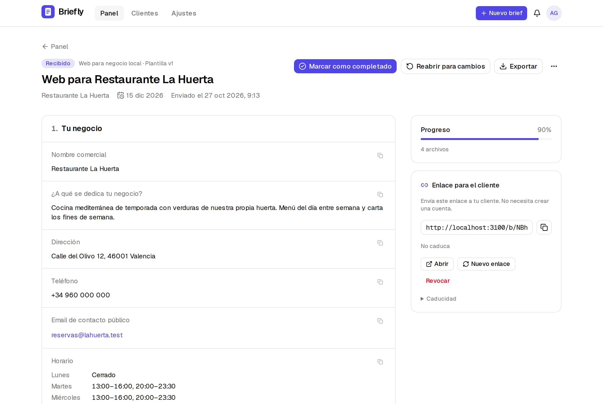

<div align="center">
  
  <h1>Briefly</h1>
  <p><strong>Recopila todo lo que necesitas de un cliente antes de diseñar su web, con un único enlace.</strong></p>
  <p><a href="README.md">Read in English</a></p>
</div>

<p align="center">
  
</p>

## Por qué

Los freelancers y pequeños estudios pierden horas persiguiendo a sus clientes por WhatsApp para conseguir el logo, el horario, los textos o las fotos. Llegan por partes, por canales distintos, y siempre falta algo cuando ya estás construyendo la web.

Briefly lo sustituye por un **cuestionario guiado que tu cliente rellena desde el móvil**. Creas un brief a partir de una plantilla, compartes un enlace privado y recibes todas las respuestas y archivos ordenados por secciones, listos para descargar o exportar.

## Funcionalidades

- **Cuestionario pensado para móvil**: pasos claros, barra de progreso, validación por paso y **guardado automático**. El cliente puede cerrar la pestaña y continuar más tarde desde el mismo enlace.
- **Subida segura de archivos**: logos, fotos y PDF se verifican por su contenido real (no por la extensión), se limpian de metadatos, tienen límites de tamaño y se guardan en privado.
- **Enlaces privados y revocables**: tokens aleatorios guardados con hash, con caducidad opcional, que puedes revocar o regenerar cuando quieras. Tu cliente no necesita cuenta.
- **Revisión ordenada**: respuestas por sección, vista previa de imágenes, copiar con un clic y exportación a **Markdown, JSON o ZIP** (respuestas + todos los archivos).
- **Panel con estados**: borrador → esperando al cliente → recibido → completado, con notificaciones cuando el cliente envía.
- **Tu marca**: muestra el nombre de tu estudio, tu logo y tu color en el cuestionario del cliente.
- **Bilingüe**: interfaz en español e inglés; cada cuestionario se envía en el idioma del cliente.
- **Plantillas declarativas**: una plantilla es un único archivo TypeScript. Añadir una es una contribución ideal para empezar.
- **Autoalojable**: un `docker compose up`, PostgreSQL y disco local o cualquier almacenamiento compatible con S3. Sin dependencia de proveedores ni IA obligatoria.

## Inicio rápido (Docker)

```bash
git clone https://github.com/iamyahyr/briefly.git
cd briefly
cp .env.example .env
```

Edita `.env` y define al menos `BETTER_AUTH_SECRET` (`openssl rand -base64 32`) y `APP_URL` (la URL pública de tu instalación). Después:

```bash
docker compose up -d
```

Abre <http://localhost:3000>, crea tu cuenta y, cuando ya exista, pon `DISABLE_SIGNUP=true` para cerrar el registro. Las migraciones de la base de datos se aplican solas al arrancar.

Más detalles (HTTPS, S3, email, copias de seguridad, actualizaciones) en [docs/self-hosting.md](docs/self-hosting.md).

## Desarrollo

Requisitos: Node.js 22+, pnpm 10+ y Docker (para PostgreSQL).

```bash
pnpm install
cp .env.example .env          # los valores por defecto sirven en local
docker compose up -d db       # PostgreSQL en localhost:5432
pnpm db:migrate
pnpm db:seed                  # opcional: cuenta demo con briefs de ejemplo
pnpm dev
```

El seed muestra un acceso de demo y un enlace de cliente que puedes abrir en otro navegador.

Comandos útiles: `pnpm lint`, `pnpm typecheck`, `pnpm test` (unitarios), `pnpm test:integration` (contra PostgreSQL real), `pnpm test:e2e` (Playwright), `pnpm db:generate` (nueva migración).

## Plantillas

Briefly incluye **«Web para negocio local»** (cafeterías, restaurantes, tiendas, estudios). Las plantillas son datos, así que crear una para fotógrafos, clínicas o tiendas online es un solo archivo: consulta [docs/templates.md](docs/templates.md).

## Contribuir

¡Las contribuciones son bienvenidas! Traducciones, plantillas, correcciones… Lee [CONTRIBUTING.md](CONTRIBUTING.md) y el [Código de conducta](CODE_OF_CONDUCT.md). Para vulnerabilidades, sigue [SECURITY.md](SECURITY.md).

## Licencia

[GNU AGPL-3.0](LICENSE). Puedes usar, modificar y autoalojar Briefly libremente. Si ofreces una versión modificada como servicio en red, debes publicar tus cambios con la misma licencia.
