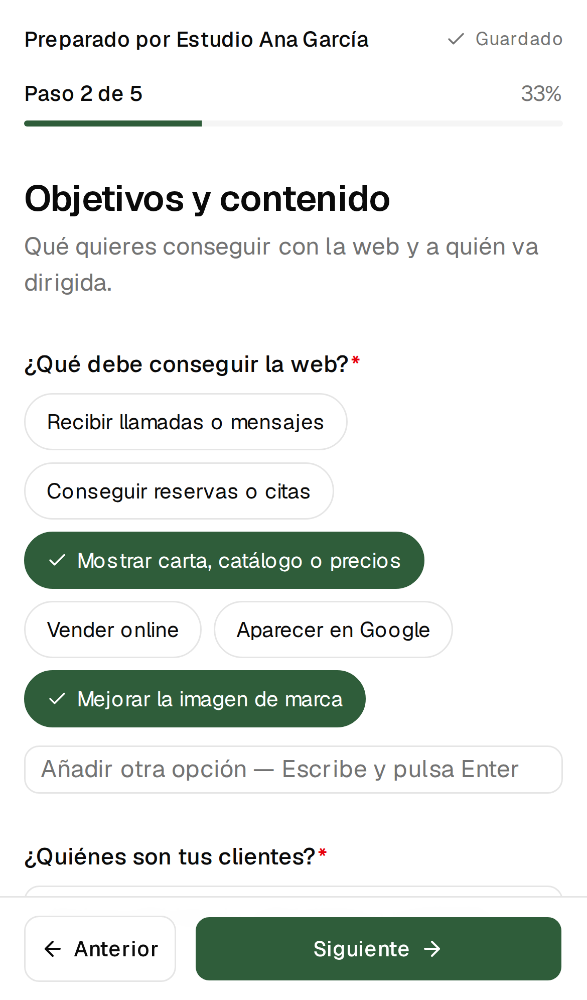
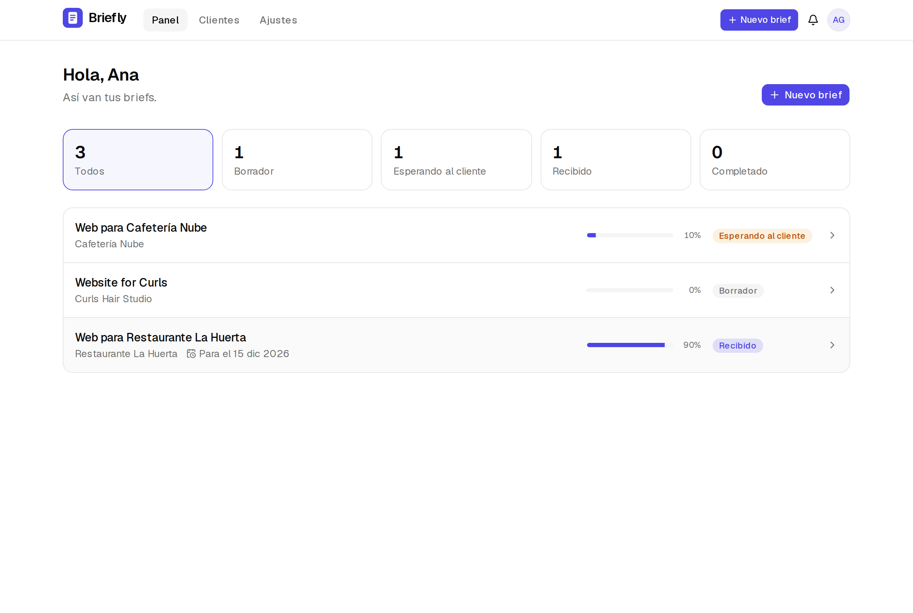

<div align="center">
  
  <h1>Briefly</h1>
  <p><strong>Collect everything you need from a client before building their website — with a single link.</strong></p>
  <p>
    <a href="https://github.com/iamyahyr/briefly/actions/workflows/ci.yml"></a>
    <a href="LICENSE"></a>
    <a href="docs/self-hosting.md"></a>
  </p>
  <p><a href="README.es.md">Leer en español</a></p>
</div>

<p align="center">
  
</p>

## Why

Freelancers and small studios lose hours chasing clients for their logo, opening hours, copy and photos — sent piece by piece over WhatsApp and email, with something always missing once the build has started.

Briefly replaces that with a **guided questionnaire your client fills in from their phone**. You create a brief from a template, share one private link, and get every answer and file organised by section, ready to download or export.

## Features

- **Mobile-first questionnaire** — clear steps, progress bar, validation per step and **autosave**: clients can close the tab and continue later from the same link.
- **Secure file uploads** — logos, photos and PDFs are checked by their real content (not the extension), stripped of metadata, size-limited and stored privately.
- **Private, revocable links** — tokens are random, stored hashed, can expire and can be revoked or regenerated at any time. No account needed for your client.
- **Organised review** — answers grouped by section, image previews, one-click copy, and export to **Markdown, JSON or ZIP** (answers + every file).
- **Dashboard with statuses** — draft → waiting for client → received → completed, with in-app notifications when a client submits.
- **Your brand** — show your studio name, logo and accent colour on the client questionnaire.
- **Bilingual** — Spanish and English UI; each questionnaire can be sent in the client's language.
- **Declarative templates** — a template is a single TypeScript file. Adding one is a great first contribution.
- **Self-hosted** — one `docker compose up`, PostgreSQL, local disk or any S3-compatible storage. No vendor lock-in, no AI required.

<table>
  <tr>
    <td></td>
    <td></td>
  </tr>
</table>

## Quick start (Docker)

```bash
git clone https://github.com/iamyahyr/briefly.git
cd briefly
cp .env.example .env
```

Edit `.env` and set at least `BETTER_AUTH_SECRET` (`openssl rand -base64 32`) and `APP_URL` (the public URL of your install). Then:

```bash
docker compose up -d
```

Open <http://localhost:3000>, create your account and, once it exists, set `DISABLE_SIGNUP=true` to close registrations. Database migrations run automatically on start.

See [docs/self-hosting.md](docs/self-hosting.md) for HTTPS, S3 storage, email, backups and upgrades.

## Development

Requirements: Node.js 22+, pnpm 10+, Docker (for PostgreSQL).

```bash
pnpm install
cp .env.example .env          # defaults work for local development
docker compose up -d db       # PostgreSQL on localhost:5432
pnpm db:migrate
pnpm db:seed                  # optional: demo account with sample briefs
pnpm dev
```

The seed prints a demo login and a client link you can open in another browser.

| Command                                        | What it does                                                |
| ---------------------------------------------- | ----------------------------------------------------------- |
| `pnpm dev`                                     | Start the dev server                                        |
| `pnpm lint` / `pnpm typecheck` / `pnpm format` | Code quality                                                |
| `pnpm test`                                    | Unit tests                                                  |
| `pnpm test:integration`                        | Data-layer tests against a real PostgreSQL (`briefly_test`) |
| `pnpm test:e2e`                                | Playwright: full freelancer → client → review flow          |
| `pnpm db:generate`                             | Create a migration after changing `src/server/db/schema.ts` |
| `pnpm db:studio`                               | Browse the database                                         |

## Configuration

All settings are environment variables — see [`.env.example`](.env.example).

| Variable                                     | Default                 | Description                                 |
| -------------------------------------------- | ----------------------- | ------------------------------------------- |
| `DATABASE_URL`                               | —                       | PostgreSQL connection string                |
| `APP_URL`                                    | `http://localhost:3000` | Public URL, used in client links            |
| `BETTER_AUTH_SECRET`                         | —                       | 32+ random characters                       |
| `DISABLE_SIGNUP`                             | `false`                 | Block new accounts                          |
| `STORAGE_DRIVER`                             | `local`                 | `local` or `s3`                             |
| `STORAGE_LOCAL_PATH`                         | `./data/uploads`        | Upload folder for the local driver          |
| `S3_ENDPOINT`, `S3_BUCKET`, `S3_…`           | —                       | Any S3-compatible service (AWS, R2, MinIO…) |
| `UPLOAD_MAX_FILE_MB` / `UPLOAD_MAX_BRIEF_MB` | `10` / `100`            | Upload limits                               |
| `SMTP_HOST`, `SMTP_…`                        | —                       | Optional, for password-reset emails         |
| `GITHUB_CLIENT_ID`, `GOOGLE_CLIENT_ID`, …    | —                       | Optional OAuth sign-in                      |

## Tech stack

Next.js (App Router) · TypeScript · Tailwind CSS · shadcn/ui · Drizzle ORM · PostgreSQL · Better Auth · next-intl · Zod · Vitest · Playwright.

Architecture notes and the security model are in [docs/architecture.md](docs/architecture.md).

## Templates

Briefly ships with **“Local business website”** (cafés, restaurants, shops, studios). Templates are plain data, so adding one for photographers, clinics or online shops takes one file — see [docs/templates.md](docs/templates.md).

## Roadmap

Template builder with conditional logic, email reminders, per-question change requests, webhooks (Linear, Slack, Notion…), more templates and team workspaces. See [ROADMAP.md](ROADMAP.md) and feel free to pick something up.

## Contributing

Contributions are very welcome — from translations and templates to bug fixes. Read [CONTRIBUTING.md](CONTRIBUTING.md) to get started. Please follow the [Code of Conduct](CODE_OF_CONDUCT.md).

Found a vulnerability? Please report it privately as described in [SECURITY.md](SECURITY.md).

## License

[GNU AGPL-3.0](LICENSE). You can use, modify and self-host Briefly freely. If you offer a modified version as a network service, you must publish your changes under the same licence.
